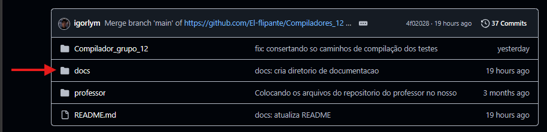
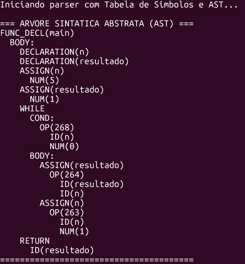
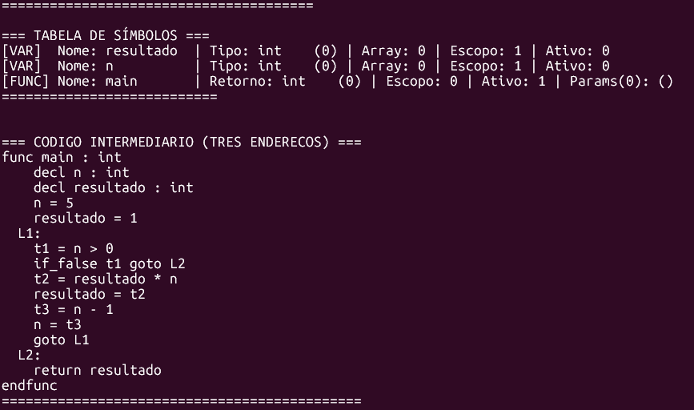
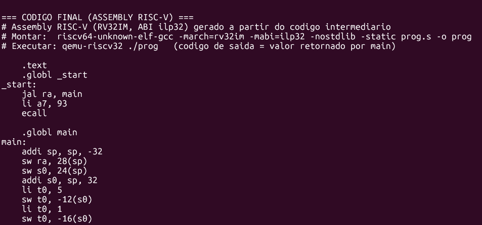
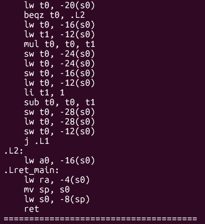

# Compilador de C -> Assembly RISC V

Este documento descreve as especificações do subconjunto da linguagem C aceito pelo nosso compilador, cujo objetivo final é a tradução para código Assembly. 

O projeto evoluiu e agora engloba as seguintes fases de compilação:
- **Analisador Léxico e Sintático:** Reconhecimento de tokens e estruturação gramatical.
- **Árvore Sintática Abstrata (AST):** Estruturação do código em uma árvore para facilitar a travessia e análise.
- **Tabela de Símbolos:** Estrutura de dados para o gerenciamento de escopos, variáveis e tipos.
- **Analisador Semântico:** Verificação de regras da linguagem (checagem de tipos, variáveis não declaradas, etc).
- **Gerador de Código Intermediário:** Tradução da AST para uma representação intermediária antes da geração do Assembly final.
- **Gerador de Código Final:** Tradução do código intermediário para Assembly RISC-V RV32IM.

---

## Equipe

<div align="center">

<table>
<tr>
<td align="center">
<a href="https://github.com/El-flipante">
<br>
<sub><b>Alexandre Henrique</b></sub><br>
</a>
</td>

<td align="center">
<a href="https://github.com/christianrolim">
<br>
<sub><b>Christiam Rolim</b></sub><br>
</a>
</td>

<td align="center">
<a href="https://github.com/igorlym">
<br>
<sub><b>Igor Lima</b></sub><br>
</a>
</td>

<td align="center">
<a href="https://github.com/joaorolim-code">
<br>
<sub><b>João Rolim</b></sub><br>
</a>
</td>

<td align="center">
<a href="https://github.com/LucasPeixotoRodrigues">
<br>
<sub><b>Lucas Peixoto</b></sub><br>
</a>
</td>
</tr>

</table>

</div>

---
## 📂 Evidências e Testes

Para manter a documentação principal enxuta, todos os detalhes de implementação, casos de teste e evidências de validação foram movidos para o diretório `/docs`.

> 🔍 **[Acessar Documentação de Testes e Evidências](./docs/testes.md)**


*(Abaixo, um guia de onde encontrar os arquivos de teste no repositório)*  


---

# Ferramentas Utilizadas

| Ferramentas | Função |
|------------|------------|
| C | Linguagem principal do compilador |
| Assembly RISC-V (RV32IM) | Linguagem final gerada pelo compilador |
| Flex | Geração do Analisador Léxico |
| Bison | Geração do Analisador Sintático  |
| WSL | Bash para Windows |
| Git | Versionamento |
| Markdown | Documentação |

---

# Documentação da Linguagem: Subconjunto C

## 1. Elementos Léxicos (Tokens)

A linguagem escolhida reconhece as seguintes categorias de tokens:

### 1.1. Palavras Reservadas (Keywords)
As seguintes palavras são reservadas e não podem ser usadas como identificadores:
* `int`, `char`, `void`, `return`, `if`, `else`, `for`, `while`

### 1.2. Identificadores
Nomes de variáveis e funções. 
* **Regra:** Devem começar com uma letra (a-z, A-Z) ou underline (`_`), seguidos por zero ou mais letras, dígitos (0-9) e/ou underline.

### 1.3. Literais
* **Inteiros:** Sequência de um ou mais dígitos de `0` a `9`.
* **Caracteres:** Um único caractere delimitado por aspas simples (ex: `'a'`, `'X'`, `'5'`).

### 1.4. Operadores e Símbolos Especiais
| Categoria | Símbolos |
| --- | --- |
| Aritméticos | `+`, `-`, `*`, `/`, `%` |
| Relacionais | `==`, `!=`, `<`, `>`, `<=`, `>=` |
| Atribuição | `=` |
| Delimitadores | `(`, `)`, `{`, `}`, `[`, `]`, `;`, `,` |

### 1.5. Comentários
* **Linha única:** Iniciados por `//` até o fim da linha.
* **Múltiplas linhas:** Delimitados por `/*` e `*/`. O conteúdo interno será ignorado pelo analisador léxico.

---

## 2. Estruturas Sintáticas

### 2.1. Declaração de Variáveis e Vetores
São suportadas declarações simples e declarações de vetores unidimensionais de tamanho fixo. A atribuição de valores a variáveis simples é feita em uma instrução separada.
* **Tipos:** a gramática reconhece `int`, `char`, `bool` e `float` para variáveis e parâmetros; `void` pode ser usado como tipo de retorno de função. A geração de Assembly usa instruções inteiras RISC-V; operações de ponto flutuante ainda não são implementadas.
* **Variáveis:** `int x;` seguido, por exemplo, de `x = 10;`.
* **Vetores:** `int numeros[10];` ou `int v[3] = {1, 2, 3};`. Inicializadores globais devem ser constantes.

### 2.2. Estruturas de Controle de Fluxo
* **Condicionais:** Estrutura `if` e `if-else`.
* **Laços de Repetição:** Estruturas `for` e `while`.

### 2.3. Funções
O programa deve conter ao menos a função principal.
* **Sintaxe:** `int main() { ... }`

---

## 3. Exemplos de Código

### 3.1. Exemplo Válido 1: Estruturas de Repetição
O código abaixo demonstra um programa válido calculando um fatorial:

```c
// Programa que calcula o fatorial de 5
int main() {
    int n;
    int resultado;
    n = 5;
    resultado = 1;
    
    while (n > 0) {
        resultado = resultado * n;
        n = n - 1;
    }
    
    return resultado;
}
```
### 3.2. Resultado esperado do fatorial





---

# Como Executar o Projeto

## Requisitos

Antes de iniciar, instale as ferramentas abaixo:

* **GCC** (compilador C)
* **Flex** (gerador do analisador léxico)
* **Bison** (gerador do analisador sintático)
* **Make** (automação da compilação)
* Em Windows, recomenda-se **WSL/Linux**. O MSYS2 também pode compilar o projeto, mas os testes que comparam saídas de texto podem encontrar diferenças de finais de linha (CRLF/LF).

## 1. Compilar o Compilador

Se ainda não tiver o repositório, clone-o e entre na pasta do código-fonte:

```bash
git clone https://github.com/El-flipante/Compiladores_12
cd Compiladores_12
```

Se o repositório já estiver na sua máquina, entre na pasta `src`. Depois compile o projeto:

```bash
cd src
make
```

O Makefile executa Bison e Flex para gerar `parser.tab.c`, `parser.tab.h` e `lex.yy.c`, e depois compila esses arquivos junto com os módulos da AST, tabela de símbolos, código intermediário e Assembly final. O executável gerado é `parser` (ou `parser.exe` em ambientes Windows).

## 2. Compilar um Programa de Entrada

O compilador lê o programa pela entrada padrão. Crie um arquivo, por exemplo `programa.c`, com código pertencente ao subconjunto da linguagem aceito pelo projeto:

```c
int soma(int a, int b) {
    return a + b;
}

int main() {
    int resultado;
    resultado = soma(20, 22);
    return resultado;
}
```

Execute o compilador redirecionando o arquivo como entrada:

```bash
./parser < programa.c
```

No MSYS2, use `./parser.exe < programa.c` caso o shell não encontre o executável sem a extensão `.exe`.

Também é possível pedir ao Make para compilar o parser, se necessário, e executar um arquivo pelo alvo `execute`. A partir da pasta `src`, informe o caminho do programa na variável `PROGRAMA`:

```bash
make execute PROGRAMA=programa.c
```

Por exemplo, para compilar o exemplo que está na pasta `docs`:

```bash
make execute PROGRAMA=../docs/fatorial.c
```

O caminho é relativo à pasta em que o comando `make` é executado. Use o nome da variável sem os sinais `<` e `>`; esses sinais são usados pelo shell para redirecionamento.

O compilador imprime a AST, a tabela de símbolos, o código intermediário de três endereços e, ao final, o Assembly RISC-V RV32IM. Para guardar toda essa saída em um arquivo:

```bash
./parser < programa.c > saida_compilador.txt
```

O Assembly final estará no último bloco da saída. Se houver erros léxicos, sintáticos ou semânticos, o compilador mostra os diagnósticos e não gera o código intermediário nem o Assembly.

> **Observação:** o projeto implementa um subconjunto de C, não a linguagem C completa. O código de entrada deve seguir as construções descritas neste README; recursos como bibliotecas (`#include`), ponteiros e funções de entrada/saída não fazem parte da gramática atual.

## 3. Executar os Testes

Na pasta `src`, execute a suíte automatizada:

```bash
make test
```

O alvo `make test` executa os seguintes grupos:

* **Tabela de símbolos (`test-symtab`):** verifica inserção e busca de variáveis, rejeição de nomes duplicados no mesmo escopo e sombreamento de um nome em um escopo interno.
* **Analisador léxico (`test-lexer`):** compara a sequência de tokens produzida para uma entrada válida e verifica diagnósticos para identificador iniciado por número, caractere inválido e escape inválido em literal de caractere.
* **AST (`test-ast-output`):** compila uma entrada simples e confere se a árvore impressa contém declaração, atribuição e operandos esperados, além de verificar a precedência de multiplicação sobre soma.
* **Casos complementares (`test-complementares`):** verifica um programa válido com protótipos e definições de função, chamadas, tipos, escopos, vetores, operadores e laços. Também confere diagnósticos semânticos, erro léxico e recuperação após erro sintático.
* **Código intermediário (`test-ir`):** compara o TAC gerado com saídas esperadas para casos de chamadas aninhadas, expressões, operadores relacionais, laços, vetores, escopos, variáveis globais e funções `void`. Verifica também que erros semânticos impedem a geração do TAC.

Para executar apenas um grupo, use, por exemplo, `make test-lexer`, `make test-ir`, `make test-ast-output`, `make test-complementares` ou `make test-symtab`.

O Makefile também define o alvo `make test-ast`, mas ele não faz parte de `make test`. No estado atual, `testes/test_ast.c` contém verificações da tabela de símbolos; por isso, a cobertura da AST descrita acima vem do teste integrado `test-ast-output`.

> **Cobertura atual:** a suíte automatizada verifica o compilador até a geração do TAC, mas ainda não possui testes que comparem o Assembly RISC-V produzido pelo `codegen` com saídas esperadas. A geração de Assembly pode ser observada executando o compilador com um programa de entrada, conforme a seção anterior.

## Estrutura do Projeto

```text
Compiladores_12/
├── README.md                  # Visão geral, linguagem e instruções de uso
├── docs/                      # Documentação, testes e evidências do projeto
├── professor/                 # Materiais e referências da disciplina
└── src/
    ├── Makefile               # Compilação e execução dos testes
    ├── lexer.l                # Regras do analisador léxico (Flex)
    ├── parser.y               # Gramática, AST e ações semânticas (Bison)
    ├── ast.c / ast.h          # Definição, construção e impressão da AST
    ├── symtab.c / symtab.h    # Tabela de símbolos e controle de escopos
    ├── ir.c / ir.h            # Geração e impressão do código intermediário (TAC)
    ├── codegen.c / codegen.h  # Geração do Assembly RISC-V RV32IM
    └── testes/
        ├── test_*.c           # Testes unitários da AST, lexer e tabela de símbolos
        ├── testar_*.sh        # Scripts dos testes automatizados
        ├── complementares/    # Entradas de teste léxicas, sintáticas e semânticas
        ├── historico/         # Entradas de testes anteriores
        └── ir/                # Casos de teste e saídas esperadas do TAC
```

Os arquivos `parser.tab.c`, `parser.tab.h` e `lex.yy.c` são gerados durante a compilação e não precisam ser editados manualmente.

# Licença

Este projeto foi desenvolvido para a disciplina **Compiladores 1** da Universidade de Brasília (UnB).
