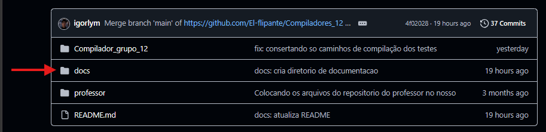

# Compilador de C -> Assembly

Este documento descreve as especificações do subconjunto da linguagem C aceito pelo nosso compilador, cujo objetivo final é a tradução para código Assembly. 

O projeto evoluiu e agora engloba as seguintes fases de compilação:
- **Analisador Léxico e Sintático:** Reconhecimento de tokens e estruturação gramatical.
- **Árvore Sintática Abstrata (AST):** Estruturação do código em uma árvore para facilitar a travessia e análise.
- **Tabela de Símbolos:** Estrutura de dados para o gerenciamento de escopos, variáveis e tipos.
- **Analisador Semântico:** Verificação de regras da linguagem (checagem de tipos, variáveis não declaradas, etc).
- **Gerador de Código Intermediário:** Tradução da AST para uma representação intermediária antes da geração do Assembly final.

---

## Equipe

<div align="center">

<table>
<tr>
<td align="center">
<a href="https://github.com/El-flipante">
<br>
<sub><b>Alexandre Henrique</b></sub><br>
</a>
</td>

<td align="center">
<a href="https://github.com/christianrolim">
<br>
<sub><b>Christiam Rolim</b></sub><br>
</a>
</td>

<td align="center">
<a href="https://github.com/igorlym">
<br>
<sub><b>Igor Lima</b></sub><br>
</a>
</td>

<td align="center">
<a href="https://github.com/joaorolim-code">
<br>
<sub><b>João Rolim</b></sub><br>
</a>
</td>

<td align="center">
<a href="https://github.com/LucasPeixotoRodrigues">
<br>
<sub><b>Lucas Peixoto</b></sub><br>
</a>
</td>
</tr>

</table>

</div>

---
## 📂 Evidências e Testes

Para manter a documentação principal enxuta, todos os detalhes de implementação, casos de teste e evidências de validação foram movidos para o diretório `/docs`.

> 🔍 **[Acessar Documentação de Testes e Evidências](./docs/testes.md)**

*(Abaixo, um guia de onde encontrar os arquivos de teste no repositório)*  


---

# Ferramentas Utilizadas

| Ferramentas | Função |
|------------|------------|
| C | Linguagem principal do compilador |
| Assembly | Linguagem final do compilador |
| Flex | Geração do Analisador Léxico |
| Bison | Geração do Analisador Sintático  |
| WSL | Bash para Windows |
| Git | Versionamento |
| Markdown | Documentação |

---

# Documentação da Linguagem: Subconjunto C

## 1. Elementos Léxicos (Tokens)

A linguagem escolhida reconhece as seguintes categorias de tokens:

### 1.1. Palavras Reservadas (Keywords)
As seguintes palavras são reservadas e não podem ser usadas como identificadores:
* `int`, `char`, `void`, `return`, `if`, `else`, `for`, `while`

### 1.2. Identificadores
Nomes de variáveis e funções. 
* **Regra:** Devem começar com uma letra (a-z, A-Z) ou underline (`_`), seguidos por zero ou mais letras, dígitos (0-9) e/ou underline.

### 1.3. Literais
* **Inteiros:** Sequência de um ou mais dígitos de `0` a `9`.
* **Caracteres:** Um único caractere delimitado por aspas simples (ex: `'a'`, `'X'`, `'5'`).

### 1.4. Operadores e Símbolos Especiais
| Categoria | Símbolos |
| --- | --- |
| Aritméticos | `+`, `-`, `*`, `/` |
| Relacionais | `==`, `!=`, `<`, `>`, `<=`, `>=` |
| Atribuição | `=` |
| Delimitadores | `(`, `)`, `{`, `}`, `[`, `]`, `;`, `,` |

### 1.5. Comentários
* **Linha única:** Iniciados por `//` até o fim da linha.
* **Múltiplas linhas:** Delimitados por `/*` e `*/`. O conteúdo interno será ignorado pelo analisador léxico.

---

## 2. Estruturas Sintáticas

### 2.1. Declaração de Variáveis e Vetores
Serão suportadas declarações simples (com ou sem inicialização imediata) e declarações de vetores unidimensionais de tamanho fixo.
* **Tipos básicos:** `int x;`, `int y = 10;`, `char letra = 'a';`
* **Vetores (Arrays):** `int numeros[10];`, `char palavra[20];` *(Nota: a inicialização de vetores no momento da declaração, como `int v[2] = {1, 2}`, não será suportada nesta versão).*

### 2.2. Estruturas de Controle de Fluxo
* **Condicionais:** Estrutura `if` e `if-else`.
* **Laços de Repetição:** Estruturas `for` e `while`.

### 2.3. Funções
O programa deve conter ao menos a função principal.
* **Sintaxe:** `int main() { ... }`

---

## 3. Exemplos de Código

### 3.1. Exemplo Válido 1: Estruturas de Repetição
O código abaixo demonstra um programa válido calculando um fatorial:

```c
// Programa que calcula o fatorial de 5
int main() {
    int n = 5;
    int resultado = 1;
    
    while (n > 0) {
        resultado = resultado * n;
        n = n - 1;
    }
    
    return resultado;
}
```

---

# Como Executar o Projeto

## Pré-requisitos

Antes de iniciar, certifique-se de possuir instalados: 

Bison, Flex, GCC, WSL(caso use Windows)/Linux 


---

## 1. Clonar o Repositório

```bash
git clone https://github.com/El-flipante/Compiladores_12

cd Compiladores_12
```

---

## 2. Compilar o analizador léxico

```bash
flex lexer.l
```

---

## 3. Compilar o analizador sintático

```bash
bison -d parser.y
```
## 4. Compilar tudo

```bash
gcc -o compilador parser.tab.c lexer.yy.c -lfl
```
---
## 5. Executar o compilador
``` bash
./compilador
```
## Estrutura do Projeto

```text
.Compiladores_12
├── Professor
├── README.md
├── parser.y
├── lexer.l
```

# Licença

Este projeto foi desenvolvido para a disciplina **Compiladores 1** da Universidade de Brasília (UnB).
