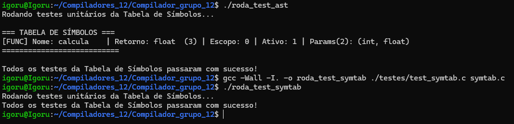

# Documentação de Testes
A suíte de testes deste compilador é dividida em duas abordagens principais: Testes Unitários em C (para validar estruturas de dados internas como a Tabela de Símbolos e a AST) e Scripts de Automação em Shell (para validar a gramática, análise léxica, sintática e tratamento de erros do compilador completo através de arquivos de texto).

## 1. Como Executar os Testes e Evidências

### 1.1 Testes Unitários (Tabela de Símbolos e AST)
Os testes unitários garantem que o escopo de variáveis, inserção, busca, redeclaração e assinaturas de funções estão funcionando corretamente na memória.

**Comandos de execução no Ubuntu (WSL):**
```bash
# Compilar e rodar os testes da AST (focado na Tabela de Símbolos e funções)
gcc -Wall -I. -o roda_test_ast ./testes/test_ast.c symtab.c
./roda_test_ast

# Compilar e rodar os testes gerais da Tabela de Símbolos
gcc -Wall -I. -o roda_test_symtab ./testes/test_symtab.c symtab.c
./roda_test_symtab
```
**Evidência de Execução:**



### 1.2 Testes de Automação (Léxico e Sintático)
Estes scripts compilam os analisadores gerados pelo Flex/Bison e injetam arquivos de texto (`.txt`) contendo casos válidos e inválidos para validar a saída do compilador.

**Comandos de execução no Ubuntu (WSL):**
```bash
# Testa a extração de tokens do analisador léxico
testar_lexico.sh

# Compila o projeto inteiro via Makefile e testa a árvore de derivação sintática
testar_sintatico.sh
```

---

## 2. Casos de Teste (Léxico, Sintático e Semântico)

Os arquivos de texto consumidos pelos scripts `.sh` contemplam os seguintes cenários estruturais:

### 2.1 Operações Aritméticas e Precedência
Verificam operações de soma, subtração, multiplicação, divisão e o respeito à precedência de operadores matemáticos e agrupamento com parênteses.
```text
5 + 3;
10 * 10;
(-15 - 4)*3;
10 / (5-3);
```

### 2.2 Números Negativos e Operadores Unários
Verificam o reconhecimento do operador unário de negação isolado e em expressões.
```text
- 45;
10 * -5;
-(14*33);
```

### 2.3 Tratamento de Erros Semânticos
Com a implementação da Análise Semântica e Tabela de Símbolos, os testes agora validam a coerência do código.

*   **Uso de variável não declarada:**
    ```text
    y - 14;  // Erro se 'y' não existir na Tabela de Símbolos
    ```
*   **Divisão por zero literal:**
    ```text
    5 / 0;   // Barrado em tempo de compilação
    ```
*   **Operação entre tipos invalidos**
    ```text
    str / 67; // Erro operação como tipo invalido
    ```

### 2.4 Tratamento de Entradas Inválidas (Erros Léxicos e Sintáticos)
Garante que o compilador rejeita caracteres e estruturas que não pertencem à gramática estabelecida.

*   **Caracteres e Símbolos não suportados:**
    ```text
    22 ¨ 44;
    700 @ 14;
    11 - 15.
    ```
*   **Expressões Incompletas (Falta de pontuação ou fechamento):**
    ```text
    (114*3;
    44 55 73;
    ```
*   **Identificadores Malformados:**
    ```text
    123erro;
    ```

---

## 3. Código Intermediário
O compilador agora traduz a Árvore Sintática Abstrata (AST) validada para Código de Três Endereços. A validação desta etapa é feita analisando a saída gerada após uma compilação bem-sucedida.

---

## 4. Resumo da Cobertura de Testes

| Etapa do Compilador | Ferramenta/Arquivo de Teste | O que é validado |
| :--- | :--- | :--- |
| **Léxico** | `testar_lexico.sh` | Geração de tokens válidos e rejeição de caracteres inválidos (`@`, `¨`). |
| **Sintático** | `testar_sintatico.sh` | Precedência (`*` antes de `+`), parênteses, e detecção de expressões malformadas. |
| **Tabela de Símbolos** | `test_symtab.c` / `test_ast.c` | Inserção, busca, shadowing, e controle de escopo (global vs local). |
| **Semântico** | Arquivos `.txt` + Compilador | Bloqueio de variáveis não declaradas, redeclarações indevidas e divisão por zero. |
| **Código Intermediário**| Saída no terminal | Tradução correta das expressões para o formato de Três Endereços. |